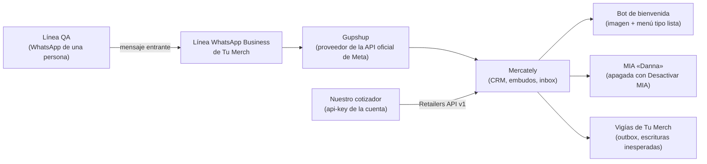

# Pruebas contra Mercately: infraestructura y protocolo

**Levantado:** 15/10/2026 por Alejo, con lecturas por API, un mensaje entrante desde la línea QA de Luup Lab y un intento de envío de texto libre. **Fuentes:** guía v2 §0, §1.3 y §1.4; condiciones de prueba de Miguel del 15/10 (en Drive, ADR-003); especificación OpenAPI pública de Mercately; issue #19; ADR-004.

> El repositorio es público: aquí no van números de teléfono, la api-key ni contenido de conversaciones. Los números de los contactos QA están en el original de la guía y en el `.env` local.

## Qué hay detrás

| Pieza | Qué sabemos | Cómo lo sabemos |
|---|---|---|
| Línea de Tu Merch | Es la del botón de WhatsApp de su web; está conectada a Mercately | El mensaje entrante de la línea QA apareció por API en la conversación del contacto |
| Conexión a WhatsApp | API oficial de Meta a través de **Gupshup**; las plantillas se envían por su `internal_id` (`gupshup_template_id`) | Especificación OpenAPI de Mercately y `GET /whatsapp_templates` |
| API de Mercately | Base `https://app.mercately.com/retailers/api/v1`, cabecera `api-key`, 35 rutas públicas. La api-key es única para toda la cuenta y escribe | Especificación OpenAPI; guía v2 §0.3 |
| Envío con API oficial | **Solo plantillas**: `POST /whatsapp/send_notification_by_id` con `phone_number`, `internal_id`, `template_params` | Especificación OpenAPI |
| Texto libre | `POST /whatsapp/send_message` es **solo para conexiones por QR**. Con la ventana abierta respondió `500 «No fue posible entregar el mensaje al número de destino»` y no salió nada | Intento único del 15/10, verificado leyendo la conversación |
| Bot de bienvenida | Ante el mensaje entrante respondió en 1–6 s con una imagen de bienvenida y un mensaje interactivo de tipo lista. **`Desactivar MIA` no lo detiene** | Conversación del contacto QA |
| MIA | No respondió al contacto con `Desactivar MIA` | Conversación del contacto QA |
| Plantillas | 28 aceptadas, todas comerciales o internas de Tu Merch; ninguna del cotizador | `GET /whatsapp_templates` |
| Firewall de la API | Corta la conexión TLS con el User-Agent por defecto de Python | Aprendizaje del 15/10 en `CLAUDE.md` |

## Consecuencias para el diseño

1. **El cotizador solo puede escribir al cliente con plantillas aprobadas por Meta**, aun dentro de la ventana de 24 h. La prohibición 6 no es solo una regla nuestra: la API pública no ofrece otra cosa para esta conexión. Enviar la cotización exige una plantilla propia del cotizador (con documento o URL) aprobada antes del piloto.
2. **El texto libre dentro de la ventana solo lo puede enviar una persona desde el inbox de Mercately.** Sirve para el traspaso al asesor, no para el cotizador.
3. **WF-02 debe descartar los mensajes del bot de bienvenida** al leer la conversación: son salientes sin marca de origen, como los de MIA y los humanos (guía §1.3).
4. **La convivencia con el bot** se acuerda con Miguel junto con MIA (P0-07): si un cliente escribe, el bot saluda antes que el cotizador.

## Protocolo para cada prueba

Antes:
1. Destino: solo un contacto QA vigente (prohibición 7). Verificar por API que tiene `prueba-luuplab` y `Desactivar MIA` justo antes de escribir.
2. Horario: L–V 08:00–18:00, sábado 08:00–13:00, `America/Bogota`.
3. Si la prueba necesita ventana abierta: la persona de la línea QA escribe primero a la línea de Tu Merch con un texto que empiece por `PRUEBA QA Luup —`. La ventana vence 24 h después del `created_time` de ese mensaje entrante.
4. Esperar la respuesta del bot de bienvenida y **no tocar su menú**: elegir una opción puede reasignar la conversación al equipo.

Durante:
5. Un solo intento por envío. Ante error o timeout, **leer la conversación antes de cualquier otra cosa**; nunca reenviar a ciegas (prohibición 4).
6. Todo texto o parámetro de plantilla dice `PRUEBA`, para que Daniela y Miguel, que también reciben avisos internos, no lo confundan con un cliente.
7. Negociaciones de prueba con prefijo `QA Luup —`, y se borran al terminar (`DELETE /deals/:id`) solo tras verificar que el id es de prueba.

Después:
8. Registrar en el issue qué se envió (plantilla y parámetros, sin teléfono), la respuesta HTTP y lo que mostró la conversación.

## Preguntas abiertas para Miguel

- ¿Se puede excluir del bot de bienvenida a los contactos con `prueba-luuplab`? Si no, ¿hay forma de distinguir por API sus mensajes?
- ¿Quién crea y somete a Meta la plantilla del cotizador, y con qué cuenta de Gupshup?
- ¿Hay límites de envío o de llamadas a la API además de los que ya vigilan sus vigías?
