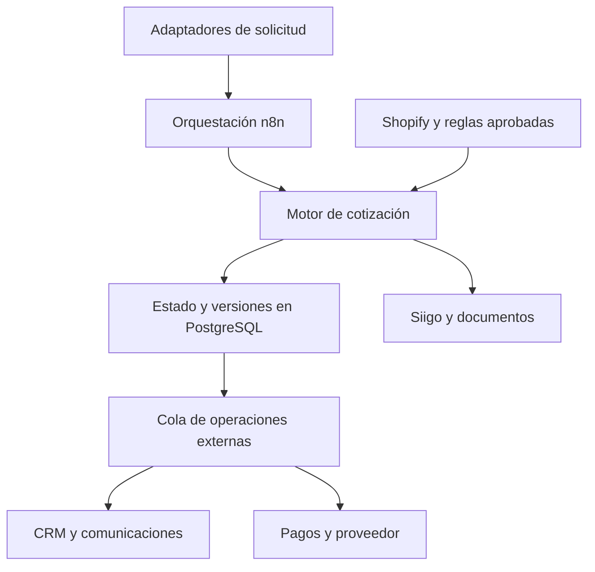
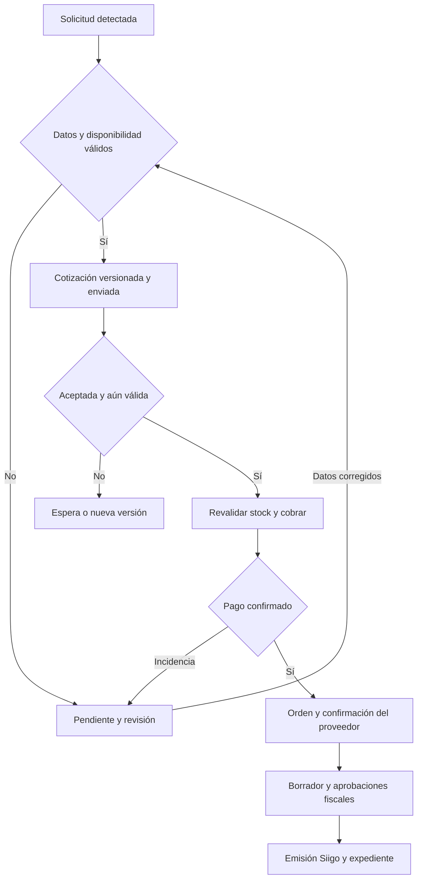

# Cotizador automático · Tu Merch × Luup Lab

Versión 0.5 · Revisión documental: 9 de octubre de 2026. Actualización de planificación, equipo y repositorio: 10 de octubre de 2026. Incorporación del alcance contractual aprobado y del cronograma recalculado: 12 de octubre de 2026, hora de Bogotá.
Estado: boceto para revisión, con el alcance contractual ya aprobado. No constituye aprobación de arquitectura, de las reglas pendientes ni de la fecha de salida. Confidencial, conforme al NDA mencionado en las fuentes.

## 1. Resultado de la revisión

Se revisaron los 13 archivos de la carpeta [Cotizador automático — Estimación (2026-09)](https://drive.google.com/drive/folders/1KcW4ClEsB1lrFokk3oUeKsiU5wDrzSji): contenido documental, enlaces de los PDF y seis imágenes de referencia. No hay subcarpetas en el listado recibido. Se buscaron también los recursos comerciales citados que no aparecen en la carpeta.

Hay información suficiente para diseñar el recorrido y los contratos de datos. Brayan aún debe compartir la calculadora; David confirma que no es necesaria para el trabajo actual y no bloquea el diseño. Será necesaria para reproducir y validar los descuentos reales. Faltan también decisiones para cerrar las integraciones de pagos, proveedor y Siigo. No se han probado las APIs, consumido los enlaces de secretos de un solo uso ni modificado sistemas operativos.

### Inventario y autoridad de las fuentes

| Fuente | Revisión y uso |
|---|---|
| [Paquete de estimación v1, PDF](https://drive.google.com/file/d/1FkvVin7SM0t2XSht9NT3KfWg3XFs9EDe/view?usp=drivesdk) | 35 páginas: definición funcional de Brayan, 19/09, más anexo técnico de Miguel, 24/09. Base de alcance y aceptación. |
| [Paquete de estimación v1, Markdown](https://drive.google.com/file/d/1-VjVJUaD_9G7iGGceZ88vHLpLIYxcyqd/view?usp=drivesdk) | Equivalente de ambos documentos. Revisado completo; facilita referencias por sección. |
| [Anexo técnico v1, PDF](https://drive.google.com/file/d/1-6cfxunLTnp7fjsAuA4CCJS8PVBlQFps/view?usp=drivesdk) | 9 páginas. Estado de sistemas, límites reportados y referencias visuales. Está también en el paquete. |
| [Guía técnica de integración v2](https://drive.google.com/file/d/1bZyWxo16AP3AjY5pSreEhEDZ3VwEQrZK/view?usp=drivesdk) | 08/10. Referencia vigente de integración y convivencia. Reemplaza expresamente la v1. |
| [Guía técnica v1, marcada obsoleta](https://drive.google.com/file/d/1G_RL0Wcdn2cJXYum0vIxeJ6yy2AgZlKQ/view?usp=drivesdk) | Revisada como antecedente. No implementar instrucciones sustituidas sobre accesos o contactos de prueba. |
| **[Roadmap aprobado, 01/10/2026](roadmap-aprobado-20261001.md)** · original [HTML](20261001_Roadmap_Cotizador_TuMerch.html) | **El artefacto que Tu Merch aprobó el 11/10 y la autoridad en materia contractual.** Cuatro etapas K/D1/D2/D3 con 38 entregables y 18 criterios, 19 casos de aceptación, 15 accesos e insumos `dep-01`–`dep-15`, 10 decisiones `dec-01`–`dec-10` y 6 exclusiones. El markdown es transcripción fiel del HTML y se regenera cuando aquel cambie. |
| [Propuesta de Luup Lab, 01/10/2026](propuesta-aprobada-20261001.md) | Documento de respaldo del roadmap: honorarios, forma de pago, equipo, soporte, riesgos y costos recurrentes de operación. Coincide con el roadmap en alcance y fechas. |
| [Mercately](https://docs.google.com/document/d/15nLjnlhCWdoosKGQDzWhBOP0VtsRIpg2I0iEwQC_wqM/edit?usp=drivesdk) y [Shopify](https://docs.google.com/document/d/1dwfN46XhRs-CB3yA-zV-SaZC4WchjHY1_tqwWqFgUFw/edit?usp=drivesdk) | Documentos de entrega de accesos por enlaces de un solo uso. Leídos; sus enlaces y contraseñas no se reproducen en esta base. |
| 01_portada.jpg; 02_ficha_producto.jpg; 03_cuerpo_cotizacion.jpg; 04_social.jpg; 05_terminos.jpg; 06_cuerpo_ejemplo2.jpg | Seis imágenes inspeccionadas: portada, ficha, tabla, página social, condiciones y segundo cuerpo. Referencias de presentación, no tablas comerciales vigentes. |

Las reglas de negocio provienen del funcional. Las precisiones técnicas del anexo resuelven algunos de sus pendientes; la guía v2 actualiza el entorno; la propuesta aprobada fija el alcance contratado y las fechas. Las contradicciones restantes deben resolverse explícitamente, sin seleccionar una interpretación por conveniencia.

**Orden de autoridad (12–13/10/2026):** el roadmap aprobado es la fuente de la verdad y gana ante cualquier contradicción; los ADR deciden lo que dejó abierto; el paquete de estimación y la guía v2 complementan en el detalle que el roadmap no cubre y no se aplican donde lo contradigan; la información nueva del cliente entra por `directives/incorporar_fuente.md`. El detalle está en `CLAUDE.md`.

Aviso de nomenclatura: en este repositorio **«v2» designa la guía técnica de integración del cliente** del 08/10. La propuesta de Luup Lab se cita siempre por su fecha, 01/10/2026, nunca como «v2», para no confundir dos documentos distintos.

### Recursos citados que no se pudieron revisar

El PDF no tiene archivos incrustados. Sus enlaces apuntan a `recursos/Calculadora_descuentos_original.xlsx` y `recursos/Modelo_cotizacion_actual.pdf`, rutas locales del paquete original, no enlaces accesibles de Drive. Ninguno aparece en la carpeta ni en las búsquedas realizadas. Esto no prueba que no existan: falta compartirlos o entregar el paquete completo.

Tampoco aparecen la plantilla Canva editable, las cinco cotizaciones recientes, diez conversaciones anonimizadas, formulario fiscal y respuestas, carpeta de expedientes, tablas M01–M09 ni el código reutilizable de Tu Merch.

### Actualizaciones confirmadas por David · 10/10/2026

| Tema | Estado vigente |
|---|---|
| Inicio del proyecto | 15 de octubre de 2026, confirmado por David. |
| Fecha de salida | Probablemente 15 de noviembre de 2026. Tentativa; falta cronograma acordado y validación de dependencias. |
| Calculadora | A la espera de Brayan. No necesaria para el diseño actual; sí para validar los descuentos reales. |
| Miguel | Es Miguel Tusso, del equipo contratante de Tu Merch. Revisor de la parte técnica; no participa en el desarrollo. |
| Desarrollo Luup Lab | Alejo y David confirmados, con mayor disponibilidad. Juanfe pendiente de participación. Responsabilidades aún no repartidas completamente. |
| Forma de trabajo | Asíncrona. Registrar avances, bloqueos, decisiones y evidencias para que el siguiente integrante pueda continuar. |

Estas aclaraciones actualizan la planificación y los roles de esta base; no modifican los documentos fuente de Tu Merch ni aprueban cambios de alcance.

### Alcance contractual aprobado · propuesta del 01/10/2026

Tu Merch aprobó el **roadmap del 01/10/2026** el 11/10, y el inicio quedó el 15/10 con el pago inicial. Ese roadmap es la fuente de la verdad del alcance: está transcrito en [`roadmap-aprobado-20261001.md`](roadmap-aprobado-20261001.md), con el HTML original al lado. Esto cierra la parte de **alcance** de P0-02; la parte de **cronograma** se trata en [ADR-001](../decisiones/ADR-001-cronograma-y-fecha-de-salida.md) y sigue pendiente de confirmación de Brayan.

Sus identificadores entran al proyecto tal como están: `dep-01`–`dep-15` para accesos e insumos, `dec-01`–`dec-10` para las decisiones del cliente, y `A01`–`A12` más `M-A01`–`M-A07` para los casos. Conviven con los `P0`/`P1`/`P2` de §8, que agrupan varios de ellos: cuando se citen juntos, el identificador del roadmap manda porque es el que ve el cliente.

| Qué quedó contratado | Detalle |
|---|---|
| Fase 1, hitos 0 a 5 | $5.000.000 COP sin IVA. 50 % al inicio, 50 % contra el acta de aceptación |
| Fase 2 y módulos, hito 6 | $5.000.000 COP sin IVA, a precio cerrado. **No contratada aún:** se activa por escrito, después de ver el cierre digital en operación y con las tablas M01–M09 entregadas |
| Opcional no contratado | Doble verificación de inventario contra las API de los dos proveedores que la exponen: $700.000 COP, 3 días |
| Soporte | 30 días incluidos por fase. Después, retainer opcional de $5.000.000 COP mensuales, cancelable mes a mes |
| Costos recurrentes de operación | A cargo de Tu Merch: infraestructura, consumo de IA de extracción, cuota de API del CRM, comisión de pasarela y licencias |

Fuera de alcance por escrito, y por tanto sujeto a cotización aparte, según la sección de exclusiones del roadmap aprobado: entrada por correo o web, verificación de inventario en las API de proveedores, selección automática del proveedor, el cotizador web o Qstomizer como canal de venta, previsualización del logo sobre el producto, y la Fase 3 de integración de proveedores. Esto confirma la frontera que el §2 de esta base pedía aclarar con operación, y acota el universo de 890 proveedores del funcional como ampliación distinta.

La propuesta aprobada exige también de Tu Merch: accesos en las fechas comprometidas, un responsable con fecha por cada decisión, revisión de los pull requests que toquen su infraestructura en 24 horas hábiles o autorización expresa para desplegar con revisión posterior, y participación de la persona comercial y de contabilidad en las pruebas de aceptación. Los tiempos de respuesta comprometidos son cuatro horas hábiles para bloqueos durante construcción y piloto, y cuatro horas hábiles para incidentes que detengan cotización o cobro durante el soporte.

## 2. Alcance que debemos preservar

**Fase 1:** solicitud sin marcación → validación de producto y variante → cálculo → cotización formal preferentemente en Siigo → documento y envío → cobro completo → confirmación de pago → orden y confirmación del proveedor → facturación con las aprobaciones fiscales exigidas → expediente y trazabilidad.

WhatsApp, correo y web deben converger en el mismo cálculo. El primer adaptador propuesto es Mercately; no se considera con ello terminada la cobertura de otros canales. El checkout y CTA web están apagados según el anexo: debemos acordar cómo se capturará una solicitud web.

**Fase 2:** marcación, tablas técnicas y arte; enfoque de copilot donde el vendedor define la técnica y revisa el borrador. Qstomizer requiere prueba de extracción y no debe bloquear fase 1. Las referencias con personalización incluida requieren clasificación explícita para evitar cobros duplicados.

No se pide reconstruir el catálogo, agregar nuevamente markup al precio Shopify ni elegir al proveedor más barato. El pedido estándar al proveedor forma parte de fase 1; integrar el universo de 890 proveedores mencionado en el funcional es una ampliación distinta. Debe aclararse esa frontera con operación.

Expediente, costos y métricas están solicitados; la profundidad y calendario de sus módulos ampliados se deben acordar, conservando trazabilidad básica desde el comienzo.

## 3. Reglas confirmadas y pendientes

| Tema | Base confirmada por las fuentes | Lo que falta cerrar |
|---|---|---|
| Precio | Shopify contiene precio de venta sin IVA, con markup de producto incorporado. No multiplicar por 1,40 otra vez. | Mapeo de variantes a códigos Siigo. |
| Descuento | Calculadora original; base de productos antes de IVA y descuento. Marcación y transporte no elevan el tramo. | Excel y pruebas en todos los límites. No usar los porcentajes históricos del anexo como sustituto. |
| IVA | Referencia del 19 %, añadido después del cálculo. | Redondeo por línea/documento y tratamiento por concepto, aprobados por contabilidad. |
| Mínimo | Metacampo de producto `custom.cantidad_minima`. | Aplicación por variante o suma de variantes y excepciones. |
| Stock | Variante correcta; solo lectura de Shopify. Sin disponibilidad no habilitar cobro. | Antigüedad máxima, doble chequeo donde haya API, reserva y concurrencia. El stock fijo de productos bajo pedido no prueba existencia física. |
| Vigencia | Cinco días hábiles con festivos de Colombia según anexo. | Si sábado cuenta, hora de vencimiento y política de nueva versión. Horario de mensajes y calendario de vigencia son reglas diferentes. |
| Transporte | Bogotá/Sabana gratis en compras superiores a $2 millones; otras ciudades a cargo del cliente. | Base antes/después de descuento/IVA, igualdad exacta al límite, municipios y tarifa bajo el umbral. Un envío histórico a Cali no define la regla nueva. |
| Pago | 100 % sin marcación; 50 % de inicio para personalizados. | Medios definitivos, confirmación bancaria, vencimiento, devolución y conciliación. No asumir tarjeta como opción predeterminada. |
| Factura | Borrador al cliente; cliente verifica y asesor autoriza emisión DIAN. | Evento fiscal, mecanismo de aprobaciones y entorno de prueba Siigo. Automatizar tareas no elimina esas aprobaciones. |
| Marcación | Costo × 1,50 cuando la fuente es costo; precio publicado no recibe segundo markup. | Tablas, unidades, montajes, técnicas, compatibilidades y clasificación costo/venta. Fase 2. |

La tolerancia aproximada ±10 % mencionada no es una política aprobada para cobrar. La IA puede extraer campos y señalar ambigüedad; no debe inventar precios, tasas, referencias ni disponibilidad.

## 4. Arquitectura propuesta para discusión

Usar n8n en el VPS Hostinger de Luup Lab para orquestar. Proponer un motor central de cálculo y persistencia transaccional en PostgreSQL, separado de los adaptadores de canal. Antes de construir otro servicio, solicitar a Miguel referencias o acceso autorizado al FastAPI/PostgreSQL y extractor Gemini ya existentes. Luup Lab evalúa su reutilización y desarrolla la solución; Miguel revisa la propuesta técnica por parte de Tu Merch y no participa en el desarrollo.

Esta arquitectura es propuesta, no decisión aprobada ni configuración existente del VPS. Debemos confirmar recursos, versión de n8n, Docker, PostgreSQL, dominio/TLS, respaldo y restauración. No se necesita acceso al VPS para terminar el diseño.

Los límites descritos aquí son reportados por Tu Merch; deberán comprobarse en el hito 0 y contra la documentación oficial vigente al implementar. La guía v2 especifica Shopify Admin API 2026-10 y client credentials; no utilizar las instrucciones de token de la v1 obsoleta.

La cola de operaciones debe distinguir intención registrada, ejecución, confirmación y resultado incierto. Idempotencia interna evita ejecutar dos veces el mismo evento; no demuestra que un proveedor externo haya recibido una operación tras un timeout. En ese caso, conciliar o revisar, sin repetir el envío a ciegas.

## 5. Boceto de workflows n8n

Los IDs siguientes son propuestos y estables para documentación y futuro repositorio. No son workflows creados ni activos. Frecuencias, nodos definitivos y endpoints se cierran después del hito 0.

| ID | Disparador y pasos principales | Resultado / bloqueo |
|---|---|---|
| WF-00 · Control de operación | Configuración `off/shadow/allowlist/live`; lista QA; restricciones por destino; horario Bogotá; pausa y reanudación. Aplicar antes de cada efecto externo. | En shadow registra intención sin escrituras/envíos; en allowlist restringe todos los efectos a entidades autorizadas. |
| WF-01 · Detectar solicitudes | Schedule → consultar negociaciones elegibles con paginación → guardar cursor y evento → deduplicar → consultar conversación y adjuntos. Propuesta inicial: polling cada 2 min, sujeto a límites, volumen y acuerdo de latencia. | Evento durable por negociación y cambio relevante; recuperación con solapamiento controlado. No asumir webhook Mercately. |
| WF-02 · Estructurar y cualificar | Extraer canal, cliente, líneas, variante, cantidades, ciudad, fecha y modalidad → validar esquema → resolver ambigüedades. | Solicitud completa o `pendiente_datos`; pregunta mediante plantilla aprobada o tarea al asesor. |
| WF-03 · Validar catálogo | Resolver IDs/SKU → leer variante, precio, stock y mínimo → verificar vigencia del dato y personalización incluida → chequear proveedor donde sea posible. | Instantánea de datos; bloqueo por stock, MOQ, dato viejo o producto ambiguo. Sin sustituciones silenciosas. |
| WF-04 · Calcular | Motor determinista → aplicar versión aprobada Excel → descuento de productos → transporte e impuestos aprobados → fecha de vencimiento → guardar líneas y totales. | Cotización versionada reproducible. Sin reglas suficientes, bloquear; nunca inventar descuentos. |
| WF-05 · Generar documento | Reservar consecutivo de forma atómica → mapear referencias/clientes Siigo → crear/consultar cotización → obtener PDF/URL → archivar y comparar totales. | Documento formal y referencias. Si Siigo no permite el formato, presentar alternativa Slides/PDF para aprobación previa. |
| WF-06 · Revisar y enviar | Revisión de piloto/excepción → comprobar versión, destinatario, exclusiones y horario → plantilla aprobada → registrar resultado → actualizar etapa CRM cuando corresponda. | Evidencia de envío; propuesta de etapa `Propuesta Enviada`. Si envío incierto, revisar antes de reintentar o mover tarjeta. |
| WF-07 · Aceptar y habilitar cobro | Detectar aceptación verificable → validar vigencia y stock nuevamente → aplicar política de reserva → crear medio de pago por importe exacto. | Cobro asociado a una revisión concreta; sin stock vigente no habilitarlo. No presuponer pago por leer un mensaje. |
| WF-08 · Confirmar pago | Evento de pasarela autenticado o consulta/conciliación aprobada → validar origen, referencia, moneda, monto y estado → deduplicar → guardar pago confirmado. | Una confirmación efectiva. Soporte enviado por WhatsApp no equivale por sí solo a pago bancario confirmado. |
| WF-09 · Ordenar al proveedor | Condiciones de compra cumplidas → proveedor asignado por regla operativa → orden por SKU → canal autorizado → registrar envío → recibir confirmación o rechazo. | Diferenciar orden enviada y aceptada; alerta por falta de confirmación. El canal WhatsApp aún debe validarse. |
| WF-10 · Facturar | Recibir Forms/datos fiscales → validar y buscar cliente → preparar borrador → aprobación del cliente → autorización del asesor → evento fiscal aprobado → emitir/consultar Siigo → archivar. | Factura confirmada y ligada al pedido. Nunca usar timeout como autorización para crear otra factura. |
| WF-11 · Expediente y operación | Cada evento → archivar documentos con permisos → registrar pedido, despacho/entrega, costos estimados/reales y referencias. | Expediente consultable; contribución provisional mientras falten costos reales. Sin forzar mockup/muestras en pedidos sin marcación. |
| WF-12 · Errores y conciliación | Error Trigger y revisiones programadas → clasificar → reintento seguro de lecturas o revisión de efectos inciertos → aviso Telegram sin datos sensibles. | Caso con responsable y resolución; recuperación desde estado persistido, no desde la memoria de una ejecución n8n. |
| WF-13 · Fase 2, copilot | Configuración validada por vendedor → datos de arte/Qstomizer → técnica y tabla vigentes → coste/venta/montajes → revisar borrador. | Reutiliza motor/documento; no duplica marcación incluida ni descuentos. |
| WF-14 · Correo y web | Adaptadores aprobados → normalizar la misma solicitud que WF-02 → mantener IDs y canal. | Consistencia entre canales; dependencias de captura y permisos pendientes. |

### Recorrido con controles

El diagrama es una secuencia conceptual. La posición exacta de facturación respecto al proveedor/despacho depende del evento que apruebe contabilidad; no queda decidida por este boceto.

## 6. Convivencia con los sistemas actuales

1. Shopify solo lectura: catálogo, variantes, precio, inventario, ubicación y metacampo de mínimo. No hay reservas mediante escritura de Shopify en este diseño. Si se requiere reserva, definirla con el proceso dueño del inventario.
2. No tocar contactos de secuencias `en-secuencia-navidad`, `en-secuencia-normal` o `secuencia-sin-fecha`; respetar también exclusiones comerciales. Revisar contacto y negociación justo antes del envío, no solo al detectar la solicitud.
3. La guía llama `Desactivar MIA` etiqueta de exclusión, pero también exige esa etiqueta para los contactos que toma el cotizador y los QA. Resolver su semántica con Miguel: no tratarla automáticamente como veto del cotizador ni como permiso de envío. Mantener separadas la exclusión comercial y la desactivación de MIA.
4. Confirmar cuándo se toma y libera la atención del contacto y cómo interviene un asesor. Mercately no expone atribución fiable humano/MIA en los salientes, según guía; una ventana de gracia no garantiza identificar al emisor.
5. Las automatizaciones nativas mueven etapas, no mandan mensajes. No duplicar sus movimientos temporizados; acordar quién enviará seguimientos y con qué plantillas. El piloto de secuencias existente sigue fuera de alcance.
6. La etapa inicial `Cantidad, Logo y Producto ✅` y mover luego a `Propuesta Enviada` son propuestas a confirmar con Miguel/Brayan; no crear ni renombrar etapas.
7. WhatsApp saliente por API: solo plantillas aprobadas según anexo. Validar soporte para documento/URL, variables y canales de órdenes a proveedor. Para clientes, L–V 08:00–18:00 y sábado 08:00–13:00, America/Bogota; fuera de horario queda en cola.
8. Guía v2 define tres contactos QA internos ya etiquetados, dos de ellos reciben avisos operativos. Identificar mensajes como prueba, negociaciones con prefijo `QA Luup —`; no asumir que contactos/mensajes pueden eliminarse. La limpieza de negociaciones requiere verificar IDs exclusivamente QA.
9. Especificidades Mercately: conservar `customer.first_name` al actualizar; `tags` al nivel raíz con objetos nombre/valor, valor false para quitar; usar el identificador textual real al actualizar negociación; normalizar nombres al comparar, pero enviar nombres exactos. Implementar tras comprobar contrato de API.
10. Despliegue gradual y reversible con evidencias, revisión de Miguel, respaldo y control de coincidencia repo/n8n. Al cierre se transfieren repo y workflows; rotación Mercately coordinada porque otros flujos usan la misma llave. La retirada de la app Shopify de construcción debe acompañarse del acceso definitivo necesario para operar.

## 7. Contrato mínimo de datos propuesto

| Registro | Campos o relaciones clave |
|---|---|
| Solicitud | ID, canal, negociación/contacto, evento origen, líneas y fecha requerida, modalidad, estado y faltantes. |
| Cotización y revisión | ID, consecutivo, versión, solicitud, instantánea Shopify, versiones de reglas, líneas, descuento, impuestos, transporte, total COP, emisión/vencimiento, aprobación, Siigo y documento. |
| Pago | ID externo, cotización/revisión, importe, moneda, estado, evidencia de verificación y eventos deduplicados. |
| Orden proveedor | ID, pedido, proveedor, SKU/variantes y cantidades, envío, confirmación, rechazo o incidencia. |
| Factura | Pedido/pago/cotización, ID Siigo, cliente fiscal, borrador, aprobaciones y estado de emisión. |
| Operación externa | Clave única por destino/acción/operación, estado, intentos, resultado, bloqueo y conciliación. |
| Evento y expediente | Entidad, fecha/origen/actor, cambio de estado, referencias documentales privadas, costos estimados/reales y soportes. |

Separar estados comercial, cotización, pago, orden y factura. Una oportunidad puede tener varias alternativas y revisiones. Guardar costos internos fuera de la cotización cliente. Mantener datos personales/fiscales fuera de URLs y logs; política de conservación y acceso pendiente de acuerdo.

## 8. Pendientes priorizados y responsables

| Prioridad / ID | Necesidad | Responsable de la fuente o decisión | Momento |
|---|---|---|---|
| P1-06 | Excel original de descuentos, fórmulas e instrucciones; cinco cotizaciones recientes y plantilla/base limpia. | Brayan/comercial | Calculadora pendiente de Brayan, confirmada por David el 10/10. No bloquea el diseño actual; requerida para implementar y validar descuentos reales. Casos y plantilla antes de aprobar cálculo/formato. |
| P0-02 | Alcance contractual efectivamente aprobado, cronograma por hitos y significado de D3. | David + Tu Merch; Miguel revisa lo técnico | **Alcance: cerrado.** Propuesta aprobada el 11/10, incorporada en §1 y en `docs/requisitos/propuesta-aprobada-20261001.md`. **Cronograma: abierto.** Inicio 15/10 confirmado; el recálculo y la propuesta de fechas están en ADR-001, pendientes de confirmación escrita de Brayan. D3 es el bloque de marcación, costeo y métricas del mes 2, según la propuesta aprobada. |
| P0-03 | Acceso reutilizable al motor/extractor/esquema existentes y decisión de arquitectura. | Luup Lab propone y desarrolla; Miguel revisa por Tu Merch | Hito 0; acceso sujeto a autorización de Tu Merch. |
| P0-04 | Siigo de pruebas; cotización, PDF/URL, códigos, cliente y factura; evento fiscal y aprobaciones. | Contabilidad + Miguel | Guía espera accesos el 15/10 y procedimiento el 21/10. Fechas por reconfirmar. |
| P0-05 | Medios de pago, confirmación, claves de prueba y decisión sobre Bold. | Brayan + contabilidad | Guía llama Bold opcional, pero el pago verificable es obligatorio en fase 1. |
| P0-06 | Proveedores iniciales, asignación, SKU, canal/formato y confirmación de órdenes. | Operaciones | Guía indica antes de D3; no define ese hito. |
| P0-07 | Semántica de MIA/exclusiones, disparador CRM, handoff, seguimientos y plantillas aprobadas. | Miguel + Brayan | Antes de habilitar cualquier envío. |
| P1-01 | Transporte completo, redondeo, vigencia y reserva/concurrencia. | Comercial + operación + contabilidad | Hito 1. |
| P1-02 | Forms, respuestas, carpeta de expedientes, permisos y conservación. | Tu Merch + contabilidad | Antes de fiscal/archivo. |
| P1-03 | Conversaciones anonimizadas y disponibilidad del equipo comercial para aceptación. | Tu Merch | Guía menciona 2 h/día el 13–14/10; reconfirmar. |
| P1-04 | Reparto de tareas y dedicación de Alejo y David; incorporación de Juanfe. | David + Alejo | Alejo y David confirmados y con mayor disponibilidad. Juanfe pendiente. Miguel Tusso pertenece al equipo contratante como revisor técnico y no desarrolla. Roles de implementación aún por repartir. |
| P1-05 | Recursos del VPS, dominio, n8n y almacenamiento; estrategia de transferencia. | Luup Lab | Antes de despliegue; DNS en configuración según David. Repositorio privado confirmado y conectado: Ramirezgon19/tu-merch. |
| P2-01 | Tablas M01–M09, Qstomizer y reglas de kits/custom; alcance de costeo y reportes ampliados. | Producción + Tu Merch + Luup Lab | Fase 2/calendario acordado. |

## 9. Plan de arranque y aceptación

Primero: preparar el diseño detallado de solicitudes, estados, validaciones y contratos de los flujos, y cerrar P0-02/03/07. Este trabajo puede avanzar antes de recibir la calculadora. Dejar la interfaz de descuentos definida y, si se usan datos ficticios de desarrollo, identificarlos expresamente como pruebas sin validez comercial. Desde el inicio del 15/10, preparar las pruebas de Siigo, pagos y pedido: son dependencias del recorrido completo.

Después: hito 0 de pruebas de integración y limitaciones → hito 1 de reglas aprobadas → motor/cotización → cierre con pago/proveedor/fiscal → shadow → QA autorizado → piloto → salida aprobada. David confirma inicio el 15/10/2026 y estima que la salida probablemente se mueve al 15/11/2026.

Sobre ese inicio, [ADR-001](../decisiones/ADR-001-cronograma-y-fecha-de-salida.md) recalcula los hitos en días hábiles y propone separar el hito contractual del 29/10 —Fase 1 en lista de permitidos, con el acta y el segundo 50 %— de la apertura a todo el tráfico, que caería el 9/11. El 15/11 de la estimación de David queda como margen disponible si una dependencia llega tarde, no como fecha adicional.

| Hito | Fecha propuesta | Estado |
|---|---|---|
| Arranque, pago inicial y accesos del hito 0 | jue 15/10 | Confirmado |
| Cotizador en sombra, sin efectos externos | jue 22/10 | Propuesto |
| Cierre digital en lista de permitidos, acta de Fase 1 | jue 29/10 | Propuesto; coincide con la fecha contractual |
| Piloto con revisión humana | vie 30/10 – vie 6/11 | Propuesto |
| Producción abierta | lun 9/11 | Propuesto; margen hasta el 15/11 |
| Tablas M01–M09 y decisión del mes 2 | mar 3/11 | Propuesto; sustituye al 23/10 de la propuesta |
| D3, marcación, costeo y métricas | 10/11 – lun 7/12 | Propuesto; sustituye al 3/11 – 27/11 |

Ninguna de estas fechas es un compromiso aprobado hasta que Brayan lo confirme por escrito. **No desplazar automáticamente cada fecha de dependencias:** el cálculo anterior es insumo para reprogramar hitos y entregas con sus responsables, uno por uno. Las fechas anteriores del 7, 13–14, 15 y 21 de octubre permanecen solo como antecedentes de la guía, y su recálculo requiere reconfirmación con cada responsable.

| Evidencia | Casos funcionales relacionados |
|---|---|
| Precio sin segundo markup, cálculo simple y multilínea, fronteras del Excel | A01–A04 |
| Variante/MOQ/stock y datos ausentes | A05–A06 |
| Totales idénticos en documento/pago/factura; envío y vencimiento | A07–A09 |
| Pedido QA completo con evidencia de pago, proveedor y factura | A10 |
| Eventos repetidos, concurrencia y respuesta incierta sin duplicación | A11 |
| Stock posterior, rechazo proveedor y error fiscal recuperables | A12 |

Añadir evidencia de separación de los bloques cliente/Tu Merch, exclusión de contactos, desactivación MIA, horario, pausa/recuperación, datos protegidos y modo shadow sin efectos. Fase 2 conserva M-A01 a M-A07 de las fuentes. Cada ejecución debe conservar resultado esperado/obtenido, versión y responsable aprobador.

## 10. Organización del futuro repositorio

Propuesta de carpetas: `docs/requisitos`, `docs/arquitectura`, `docs/decisiones`, `docs/operacion`, `workflows`, `motor`, `schemas`, `tests`, `infra` y `config`. Mantener README con estado, alcance, índice y cómo ejecutar pruebas. Repositorio privado confirmado: [Ramirezgon19/tu-merch](https://github.com/Ramirezgon19/tu-merch). GitHub conectado el 10/10/2026; documentación inicial incorporada. Las carpetas de implementación se crearán cuando tengan contenido.

Registrar requisitos RQ, decisiones ADR, workflows WF y casos A con IDs estables. Cada tarea debe tener responsable, fuente, dependencias y criterio de terminado. Una solicitud de cambio indica impacto en alcance, precio, fechas y aceptación. El código y las exportaciones n8n se revisan por cambios antes de desplegar; la versión publicada debe corresponder al repo.

Guardar `.env.example` sin valores y configuración de muestra sin datos reales. Excluir secretos, enlaces de un solo uso, conversaciones, teléfonos QA, RUT y documentos de clientes del repositorio. Para fuentes bajo NDA, usar referencias y un espacio privado con acceso acordado, no redistribución pública.

En cada futura sesión actualizar esta base mediante una nueva versión o reemplazo controlado: hecho, pendiente, bloqueado y decisiones aprobadas. El siguiente entregable recomendado es el diseño detallado WF-01 a WF-06, con contrato JSON y manejo de excepciones. Puede prepararse sin la calculadora: documentar el punto de integración de descuentos y completar sus reglas y pruebas cuando Brayan la entregue. Confirmar el disparador antes de implementarlo.

### Trabajo asíncrono del equipo

Cada tarea deberá indicar ID, resultado esperado, responsable asignado, estado, dependencia, evidencia y siguiente acción. Un único responsable por tarea facilita el seguimiento, aunque haya colaboración. Hasta acordar el reparto, mantener responsables de implementación como «por asignar», sin atribuir especialidades a Alejo o David.

Al terminar un bloque de trabajo, dejar un registro breve: qué cambió, cómo se verificó, qué queda pendiente y qué decisión o dato se necesita. Separar tareas listas para continuar de las bloqueadas por terceros. Registrar la revisión técnica de Miguel como revisión del cliente, no como capacidad de desarrollo del equipo.

### Historial de cambios

- v0.1 · 09/10/2026: revisión de las fuentes y boceto inicial.
- v0.2 · 10/10/2026: inicio 15/10, salida tentativa 15/11, rol de Miguel aclarado, Alejo/David confirmados y Juanfe pendiente; diseño desacoplado de la recepción de la calculadora; pautas de trabajo asíncrono.
- v0.3 · 10/10/2026: GitHub conectado; David confirmó el repositorio privado `Ramirezgon19/tu-merch`; documentación inicial incorporada.
- v0.4 · 12/10/2026: roadmap aprobado del 01/10 incorporado como fuente de autoridad contractual, transcrito a markdown y con su HTML original en el repositorio, junto con la propuesta que lo respalda; alcance contratado, exclusiones, honorarios y dependencias exigidas registrados en §1; parte de alcance de P0-02 cerrada; cronograma recalculado sobre el inicio del 15/10 en ADR-001 y reflejado en §9, pendiente de confirmación de Brayan; aviso de nomenclatura sobre «v2»; `CLAUDE.md` y `AGENTS.md` añadidos con las reglas para personas y agentes de código.
- v0.5 · 13/10/2026: el roadmap aprobado pasa a primera autoridad; el paquete y la guía v2 quedan como complementos de detalle; nueva directiva para incorporar información del cliente; ADR-003 propone dónde almacenar las fuentes, con el hallazgo de que el repositorio es público.
